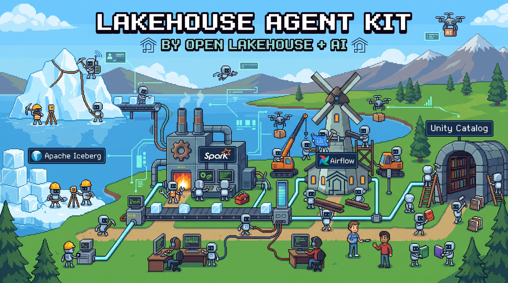

<div align="center">



# 🏞️ Lakehouse Agent Kit

### Teach your coding agent to run an open lakehouse — no cloud vendor required.

**Cross-agent [Agent Skills](https://agentskills.io) for Apache Spark · Delta Lake · Apache Iceberg · Unity Catalog (OSS) · Kafka · Airflow · MLflow · Delta Sharing.**

The open-source cousin of the Databricks agent toolkit — but for *your* stack, wherever it runs.

<sub>🧪 **Status: v0.1 — foundations landed & cross-reviewed, engine skills in flight.** Apache-2.0.</sub>

</div>

---

## 🤔 What is this?

Drop these skills next to your coding agent and it stops guessing about your lakehouse. Ask it to *"compact the small files on the orders Iceberg table"* or *"wire this Kafka topic into a Structured Streaming job"* and it already knows the engine's CLI, the gotchas, and — crucially — **where your services actually live**.

It's a parent skill, `lakehouse-core`, that figures out *how to connect*, then hands off to a focused **product skill** for the engine you're using. Each skill is plain Markdown with [progressive disclosure](https://agentskills.io/specification) (`SKILL.md` + `references/` + `scripts/`) that drives the engine's own CLI — no magic, no lock-in.

```
          you ──▶  lakehouse-core  ──▶  spark / delta / iceberg / kafka / …
                   (connect + route)     (drive the native CLI)
```

## ✨ Why it's different: it adapts to *your* deployment

The [`open-lakehouse`](https://github.com/open-lakehouse/open-lakehouse) reference stack already ships great built-in skills — but they're **welded to one Docker Compose setup**: hardcoded `localhost` ports, container names, repo paths. Copy them to a different cluster and they quietly break.

This kit rips out every hardcoded assumption and replaces it with two ideas:

### 1. 🔌 A connection profile, not hardcoded hosts
Endpoints, credentials, and invocation modes (local binary / `docker exec` / `kubectl`) come from a **[lakehouse connection profile](docs/connection-profile.md)** — a small TOML/env file — never from a value baked into a skill. Ship your profile, the skills follow.

### 2. 🧭 "Discover, don't hardcode; prefer, don't guess"
Every skill resolves an endpoint in a fixed order, so it works whether or not you've configured anything:

| Step | What happens |
|------|--------------|
| **1. Config** | Your profile / env value wins, always. |
| **2. Discover** | Not set? Probe the live environment — is the service reachable? which container is up? |
| **3. Prefer** | Still ambiguous? Fall back to the conventional port (and *verify* it answers before trusting it). |
| **4. Fail loud** | Nothing works? Stop and tell you exactly what to set — never silently assume. |

…and a hard rule the agent never crosses: it discovers **topology** (where things are), but it **never guesses identity** — *which* catalog, schema, bucket, or credentials to touch is always confirmed with you. 🔒

> This isn't just documented — it's **CI-enforced.** A linter fails the build if a skill hardcodes `:9092` or `sc://localhost:15002` as an assumption instead of resolving it. The whole point is that the toolkit can't rot back into one-stack-only.

## 🧰 The skill roster

| Skill | Covers | v0.1 |
|-------|--------|------|
| 🧭 **lakehouse-core** | Connect, profile selection, version-floor check, endpoint resolver, routing | ✅ shipping |
| ⚡ **spark** | Spark (Connect-first), `spark-submit` gotchas | 🚧 next |
| 🔺 **delta** | Delta ops: `OPTIMIZE` / `VACUUM` / `MERGE` / time travel / CDF / UniForm | 🚧 next |
| 🧊 **iceberg** | Iceberg: compaction, snapshots, schema evolution | 🚧 next |
| 📚 **unity-catalog** | UC OSS REST, Spark wiring, credential vending | 🚧 next |
| 🌊 **kafka** | Topics, connectors, Structured Streaming read/write | 🚧 next |
| 🪁 **airflow** | DAG authoring, Airflow 2→3 changes, triggering Spark | 🚧 next |
| 🔬 **mlflow** | Tracking, autologging, registry, AI gateway | 🚧 next |
| 🛠️ **sdp** | Spark Declarative Pipelines (`pyspark.pipelines` + CLI) | 🚧 next |
| 🤝 **delta-sharing** | Open sharing: server + client profile | 🚧 next |
| 🪣 **object-store** | S3-compatible stores (MinIO / SeaweedFS) | 🚧 next |

Plus an opt-in **`reference-stack`** profile that reproduces the `open-lakehouse` Compose stack so everything works out of the box on day one.

## 🚀 Install

Skills are just folders with a `SKILL.md`. Grab the kit, then point your agent at them:

```bash
git clone https://github.com/open-lakehouse/lakehouse-agent-kit
cd lakehouse-agent-kit
```

Then drop the skills into your agent's skills directory. 🧩 **This kit is built to the open [Agent Skills spec](https://agentskills.io/specification)**, so the neutral `.agents/skills/` path works for most agents:

```bash
# Project scope — the neutral spec path (Cursor, Codex, Copilot, OpenCode, Pi all read this)
mkdir -p .agents/skills && cp -r skills/lakehouse-core .agents/skills/
#            …repeat for each product skill you want (skip skills/_template)
```

### Per-agent targets

| Agent | Project scope | Personal scope |
|-------|---------------|----------------|
| **Claude Code** | `.claude/skills/` | `~/.claude/skills/` |
| **Codex** (OpenAI CLI) | `.agents/skills/` | `~/.agents/skills/` |
| **Cursor** | `.agents/skills/` or `.cursor/skills/` | `~/.agents/skills/` or `~/.cursor/skills/` |
| **GitHub Copilot** | `.github/skills/` or `.agents/skills/` | `~/.copilot/skills/` or `~/.agents/skills/` |
| **OpenCode** | `.opencode/skills/` | `~/.config/opencode/skills/` |
| **Pi** | `.pi/skills/` or `.agents/skills/` | `~/.pi/agent/skills/` or `~/.agents/skills/` |
| **Omnigent** | *bundled with the agent config* — see below | — |
| **Hermes** | *see below* | — |

Most agents **auto-discover** skills on startup and load one when its description matches your request; some let you force it with `/lakehouse-core`. (Reload or restart after copying.)

<details>
<summary><b>Omnigent & Hermes</b> (skill-install path not yet publicly documented)</summary>

- **Omnigent** loads skills from the **agent's bundle/config** rather than a user directory — an agent advertises its skills and loads one via its `load_skill` tool. To add these skills, include them in the agent's config bundle; consult your Omnigent agent-config docs for the exact `skills:` location. *(We won't print a path we can't verify.)*
- **Hermes** — its skills mechanism isn't publicly documented yet. If it supports the Agent Skills spec, the neutral `.agents/skills/` convention is the thing to try; otherwise point it at the skills via its own instructions/config.

Know the exact mechanism for either? PRs to this table very welcome. 🙏
</details>

### Coming soon 🛣️

```bash
# one-command cross-agent installer (auto-detects your agents)
uvx lakehouse-agent-kit install

# or via plugin marketplace
claude plugin marketplace add open-lakehouse/lakehouse-agent-kit
```

## 🗺️ Roadmap

- [x] **Phase 1 — Foundations:** `lakehouse-core`, connection-profile contract, skills linter, CI.
- [x] **Phase 1.5 — Generalization engine:** shared endpoint resolver (discover-then-prefer) + lint rules that *enforce* it, and a cited `reference-stack` profile.
- [ ] **Phase 2 — Engine skills:** port the 9 engine skills, each parameterized, each cross-reviewed.
- [ ] **Phase 3 — Reference-stack ops:** lifecycle / dashboard runbooks (opt-in).
- [ ] **Phase 4 — Distribution:** plugin marketplace + `pip`/`uvx` installer.
- [ ] **Phase 5 — MCP (optional):** complementary live-tools layer.

Full design, rationale, and open decisions live in [`IMPLEMENTATION_PLAN.md`](./IMPLEMENTATION_PLAN.md).

## 🛠️ How it works (under the hood)

1. **`lakehouse-core` loads your profile** and refuses to guess which one — you pick it (just like the Databricks "never auto-select a profile" rule).
2. It **checks the tool version floor** so skills don't hand you commands your CLI is too old to run.
3. It **routes** to the product skill for your engine.
4. That skill **resolves each endpoint** (config → discover → prefer → fail) and drives the engine's **native CLI** with the right invocation mode.

## 🤝 Contributing

We'd love help porting engine skills and adding deployment profiles. Start with the skill-authoring contract in [`CONTRIBUTING.md`](./CONTRIBUTING.md) and copy [`skills/_template/SKILL.md`](./skills/_template/SKILL.md). The golden rule: **resolve, don't hardcode** — the linter will hold you to it. Every skill is cross-reviewed by a different-vendor agent before a human merges.

## 📜 License

[Apache-2.0](./LICENSE).

<div align="center">
<sub>Built by the Open Lakehouse community 🤖 + AI. Pixel robots not included.</sub>
</div>
