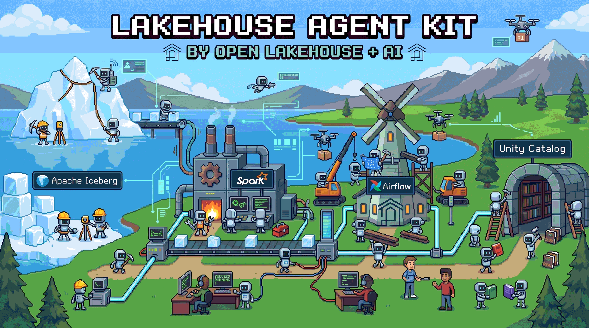

<div align="center">

# 🏞️ Lakehouse Agent Kit

### Give any coding agent a safe, portable way to operate an open lakehouse.

**Agent Skills for Apache Spark, Delta Lake, Apache Iceberg, Unity Catalog OSS, Kafka, Airflow, MLflow, Delta Sharing, and S3-compatible storage.**

[](https://github.com/open-lakehouse/lakehouse-agent-kit/actions/workflows/skills-ci.yml)
[](https://agentskills.io/specification)
[](LICENSE)



**[Install the core skill](#install)** · **[Understand the safety model](#safety-boundary)** · **[Build the next engine skill](CONTRIBUTING.md)**

</div>

---

Your coding agent probably knows Spark syntax. It does not know which Spark cluster you mean, whether the Kafka CLI lives on the host or in a container, which catalog is safe to touch, or where credentials are allowed to come from.

Lakehouse Agent Kit supplies that missing operational contract. Its parent skill, [`lakehouse-core`](skills/lakehouse-core/SKILL.md), selects and validates an explicit connection profile, resolves service endpoints without baking in one deployment, checks tool versions, and routes work to focused engine skills. The instructions follow the open [Agent Skills specification](https://agentskills.io/specification), so the same skill source can travel between coding agents.

The central rule is simple:

> 🧭 **Discover topology. Never guess identity.**

The kit may determine where a service is listening. It does not silently choose the profile, catalog, schema, bucket, table, or credentials on which an action has consequences.

## ⚡ The 60-second tour

```text
request
  │
  ▼
🧭 lakehouse-core
  ├─ select an explicit profile          never auto-select
  ├─ validate endpoints and secret refs  never print secret values
  ├─ resolve topology                    config → discover → prefer → fail
  ├─ check CLI version floors            stop on incompatible tools
  └─ route by task
       ├─ Spark
       ├─ Iceberg / Delta
       ├─ Kafka / Airflow / MLflow
       └─ catalogs, sharing, and storage
```

An agent can use one profile with local binaries, Docker containers, or Kubernetes pods. Deployment-specific values stay in the profile; product knowledge stays in the skill.

## ✨ What changes for the agent

| Without Lakehouse Agent Kit | With Lakehouse Agent Kit |
|---|---|
| Reuses a remembered `localhost` port | Resolves the endpoint and records how it was found |
| Picks the only profile because it looks obvious | Stops and asks the operator to select a profile |
| Places tokens or passwords in config | Accepts only references to credential environment variables |
| Assumes the CLI is installed locally | Uses the profile's `local`, `docker`, or `k8s` invocation mode |
| Runs a command supported by a newer tool | Checks the product skill's version floor first |
| Improvises support for an unfinished engine skill | States that the skill is not shipped yet |

These are executable constraints, not style guidance. The repository linter rejects hardcoded endpoints, container assumptions, invalid skill links, oversized instructions, and non-portable frontmatter. Self-tests cover ambiguous discovery, invalid profiles, version comparisons, and secret-bearing inputs.

## 📦 What ships today

**Status: v0.1 foundations.** The routing and portability layer is implemented and tested. Product-specific engine skills remain on the roadmap.

| Component | Purpose | Status |
|---|---|---|
| 🧭 [`lakehouse-core`](skills/lakehouse-core/SKILL.md) | Profile selection, validation, endpoint resolution, invocation modes, version floors, and routing | ✅ Shipping |
| 🔌 [`load_profile.py`](skills/lakehouse-core/scripts/load_profile.py) | Load TOML, `.env`, or environment-based profiles without exposing secrets | ✅ Shipping |
| 📡 [`resolve_endpoint.py`](skills/lakehouse-core/scripts/resolve_endpoint.py) | Resolve configured, discovered, or verified preferred endpoints with provenance | ✅ Shipping |
| 📏 [`version_floor.py`](skills/lakehouse-core/scripts/version_floor.py) | Compare real CLI output with a required version floor | ✅ Shipping |
| 🧪 [`lint_skills.py`](scripts/lint_skills.py) | Enforce the portable skill-authoring contract in CI | ✅ Shipping |
| ⚙️ Spark, Delta, Iceberg, Unity Catalog, Kafka, Airflow, MLflow, SDP, Delta Sharing, object-store skills | Engine-specific operations routed through `lakehouse-core` | 🚧 Planned |
| 📦 Cross-agent installer and generated plugin bundles | One-command distribution | 🗺️ Planned |

The [implementation plan](IMPLEMENTATION_PLAN.md), [roadmap](ROADMAP.md), and [ready-to-file backlog](BACKLOG.md) describe the remaining work without presenting it as released functionality.

<a id="install"></a>

## 🚀 Install

### 1. Clone the canonical toolkit

```bash
git clone https://github.com/open-lakehouse/lakehouse-agent-kit.git
cd lakehouse-agent-kit
```

### 2. Install `lakehouse-core`

Agent Skills are directories. Copy or symlink the shipped skill into the scope used by the coding agent.

| Agent | Project scope | Personal scope |
|---|---|---|
| Claude Code | `.claude/skills/` | `~/.claude/skills/` |
| Codex | `.agents/skills/` | `~/.agents/skills/` |
| Cursor | `.agents/skills/` or `.cursor/skills/` | `~/.agents/skills/` or `~/.cursor/skills/` |
| GitHub Copilot | `.github/skills/` or `.agents/skills/` | `~/.copilot/skills/` or `~/.agents/skills/` |
| OpenCode | `.opencode/skills/` | `~/.config/opencode/skills/` |
| Pi | `.pi/skills/` or `.agents/skills/` | `~/.pi/agent/skills/` or `~/.agents/skills/` |
| Omnigent | `.agents/skills/` when the host exposes the shared Agent Skills catalog | Host-dependent |

For example, install the core skill for a project that uses the neutral `.agents` path:

```bash
mkdir -p /path/to/project/.agents/skills
cp -R skills/lakehouse-core /path/to/project/.agents/skills/
```

Restart or reload the agent after installation. Product skills are not yet present; do not copy `skills/_template` as a usable skill.

### 3. Create a connection profile

Copy one of the generic templates and replace every placeholder with values for the target deployment:

```bash
cp templates/lakehouse.profile.example.toml ./dev.profile.toml
$EDITOR ./dev.profile.toml
python3 -I skills/lakehouse-core/scripts/load_profile.py \
  --file ./dev.profile.toml \
  --require spark
```

TOML profiles require Python 3.11 or later. The equivalent `.env` profile works with Python 3.8 or later. See the [connection-profile reference](docs/connection-profile.md) for every field and the [`open-lakehouse` reference profile](templates/reference-stack.profile.toml) for a complete deployment example.

Secrets never belong in a profile. A field such as `token_env` contains the **name** of an environment variable; the credential remains in the process environment.

## 🧭 How endpoint resolution works

Every supported endpoint follows one order:

| Tier | Decision |
|---|---|
| **1 · Config** | The value in the operator-selected profile or environment wins. It remains authoritative even when a reachability probe warns. |
| **2 · Discover** | Probe explicit candidates or, in Docker mode, inspect the configured service's published port. Ambiguity is an error. |
| **3 · Prefer** | Try the service's conventional local endpoint only when it is reachable, and label the result as a preference. |
| **4 · Fail** | Stop and name the profile key or environment variable that must be set. |

The shared resolver implements this behavior once. Product skills call it instead of reproducing discovery logic or typing remembered ports.

<a id="safety-boundary"></a>

## 🛡️ The safety boundary

Lakehouse Agent Kit separates facts that software can discover from choices that belong to the operator.

### The kit can discover

- whether a configured service endpoint is reachable;
- which endpoint a specifically named Docker service publishes;
- how an engine CLI must be invoked;
- whether an installed tool satisfies a declared version floor; and
- which product skill owns a task.

### The kit must ask

- which connection profile to use, even when only one exists;
- which catalog, schema, table, bucket, or warehouse is the intended target;
- whether a credential-bearing environment variable may be used; and
- whether an operation with destructive or irreversible effects is authorized.

Profile validation rejects credentials embedded in URIs or fields. Errors identify the location of invalid data without echoing its value. The endpoint resolver likewise suppresses candidate values and credential material in success and failure output.

## 🧪 Verify the kit

The local verification sequence is the same sequence used by [Skills CI](.github/workflows/skills-ci.yml):

```bash
python3 -I scripts/lint_skills.py
python3 -I scripts/lint_skills.py --self-test
python3 -I skills/lakehouse-core/scripts/load_profile.py --self-test
python3 -I skills/lakehouse-core/scripts/version_floor.py --self-test
python3 -I skills/lakehouse-core/scripts/resolve_endpoint.py --self-test
```

A successful run ends with the skill linter reporting clean skills and each helper reporting `self-test OK`.

## 🗺️ Repository map

| Path | Use it when… |
|---|---|
| [`skills/lakehouse-core/`](skills/lakehouse-core/) | Installing or changing the shipped parent skill |
| [`skills/_template/`](skills/_template/) | Starting a new product skill |
| [`docs/connection-profile.md`](docs/connection-profile.md) | Adding a deployment or resolving a profile validation error |
| [`templates/`](templates/) | Creating a generic or reference-stack profile |
| [`scripts/lint_skills.py`](scripts/lint_skills.py) | Checking portability and skill structure |
| [`CONTRIBUTING.md`](CONTRIBUTING.md) | Implementing or reviewing an engine skill |
| [`reference-stack/`](reference-stack/) | Working with deployment-specific `open-lakehouse` operations |
| [`IMPLEMENTATION_PLAN.md`](IMPLEMENTATION_PLAN.md) | Understanding design decisions and acceptance contracts |

## 🤝 Contributing

Engine knowledge belongs in focused product skills; deployment knowledge belongs in profiles; concrete stack operations belong in `reference-stack/`. That separation is the contribution contract.

Start with [CONTRIBUTING.md](CONTRIBUTING.md), copy [`skills/_template/SKILL.md`](skills/_template/SKILL.md), and run the complete verification sequence before opening a pull request. The linter will reject hardcoded topology, missing skill links, and non-portable metadata with `file:line` diagnostics.

The highest-value next contributions are the planned Spark, Delta Lake, Apache Iceberg, Unity Catalog OSS, Kafka, Airflow, MLflow, Spark Declarative Pipelines, Delta Sharing, and object-store skills listed in the [backlog](BACKLOG.md).

## 📜 License

Lakehouse Agent Kit is licensed under the [Apache License 2.0](LICENSE).

<div align="center">

**Open lakehouse knowledge should travel with the agent—not with one vendor's deployment.** 🌊

</div>
